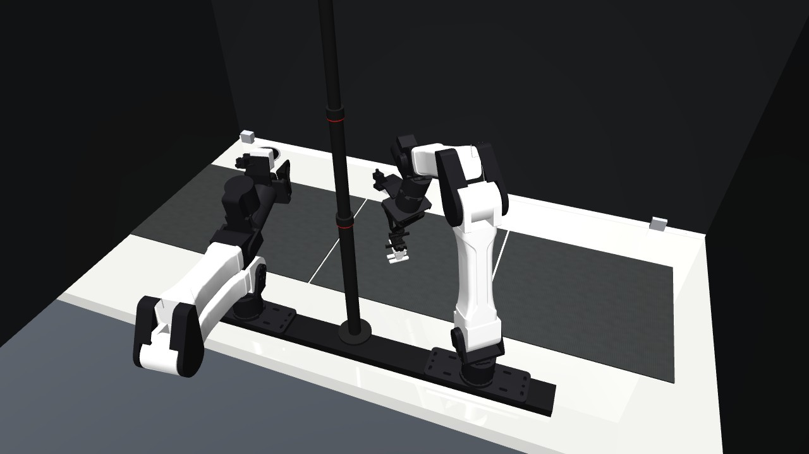
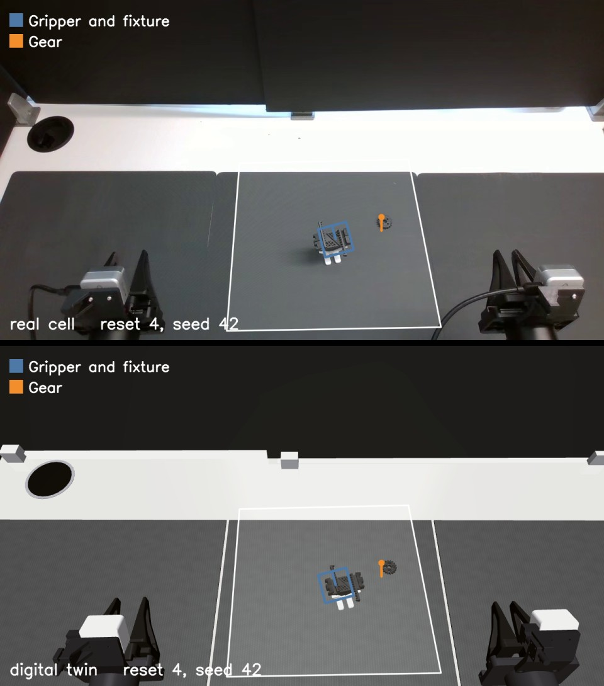
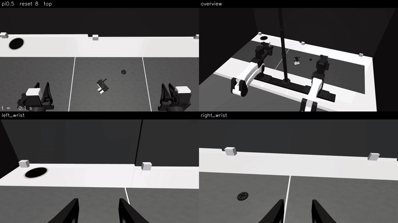

# armnet-digital-twins

[](https://huggingface.co/spaces/SalZa2004/armnet-biyam-digital-twin)
[](LICENSE)
[](https://www.python.org/downloads/)

MuJoCo digital twins of [armnet](https://armnet.dev) robot cells. A twin is a calibrated cell (robot, cameras, arm
controller and room) plus a task: its objects, its scene resets and a verifier that grades each episode. Policies get
the cell's camera frames and joint states and command the arms as they would on the real cell.

The first twin is the bimanual YAM cell with `insert_gear_in_gripper`: pick up a printed gear and push it down
between the jaws of a printed gripper.



## Try it in your browser

[YAM Sim Viewer](https://huggingface.co/spaces/SalZa2004/armnet-biyam-digital-twin), a Hugging Face Space built by
Salvina ([@SalZa2004](https://huggingface.co/SalZa2004)), runs the same cell and task with nothing to install:

- **Replays:** a 3D view of the sim that you can orbit, zoom and scrub, reset by reset. Real evaluation episodes'
  arm commands drive it, with the real and sim camera videos playing in step below.
- **Teleop:** the scene runs live in the browser on MuJoCo compiled to WebAssembly, and you move the grippers with
  on-screen buttons or the keyboard.

## Install

```bash
pip install -e .            # the twin and the replay example
pip install -e ".[pi05]"    # adds LeRobot for the pi0.5 example
pip install -e ".[warp]"    # adds MuJoCo Warp, to run the physics on a CUDA GPU
```

With uv, `uv run` and `uv sync` in this repo install everything, including both extras and pytest, so the examples
run directly, for example `uv run python examples/eval_pi05.py --engine warp`. Add `--no-dev` to get the twin alone.

Needs Python 3.12. On Linux, rendering runs headless through EGL.

The pi0.5 example also needs:

- Access to the gated [PaliGemma tokenizer](https://huggingface.co/google/paligemma-3b-pt-224). Accept its licence,
  then run `hf auth login`.
- A C compiler and Python headers (for example `apt install build-essential python3-dev`), because LeRobot builds
  `evdev` from source.
- Optionally a CUDA GPU with about 10 GB of memory. On an RTX 5090 the full 50 episode evaluation takes about 7
  minutes. On CPU an episode runs at about real time, so it takes around an hour.

## Examples

Replay a real episode of [villekuosmanen/insert_gear_in_gripper](https://huggingface.co/datasets/villekuosmanen/insert_gear_in_gripper)
in the twin from its logged actions. This writes `outputs/replay_ep10.mp4`, with the real and sim camera views side
by side:

```bash
python examples/replay_real_episode.py --episode 10
```

The replay is open loop, so small contact differences add up and most replays miss the grasp. Episode 10 still
picks up the gear and puts it on the holder.

Evaluations in the twin start from the same layouts as on the real cell. Before each real episode, the operator
places the objects as the cell's reset prompt shows them. For the same seed and reset index, the twin places them
the same way. Here are the real cell (top) and the twin (bottom) at the start of reset 4, each under its prompt:



Run [pi0.5](https://huggingface.co/fanqi-robo/pi05_insert_gear_in_gripper_b0) on a few resets and render each
rollout:

```bash
python examples/eval_pi05.py --episodes 3 --render
```

Each video shows the top camera, an overview of the cell and both wrist cameras. The pi0.5 policy sees the top and
wrist cameras. Below is reset 8 from a full evaluation on the GPU engine. pi0.5 inserts the gear after 12.4 s, one of
its 4 successes in 50 episodes in that run:



Run the full evaluation of 50 episodes. Episodes run 10 at a time (`--worlds`), and the policy handles them in one
batch. The checkpoint runs in bfloat16, so an episode's actions depend slightly on the batch it runs in. Keep
`--worlds` the same when comparing runs. Results go to `outputs/eval_pi05_<time>/results.json`:

```bash
python examples/eval_pi05.py
python examples/eval_pi05.py --engine warp    # the physics on the GPU
```

## Using the twin

```python
from armnet_digital_twins import DigitalTwin

twin = DigitalTwin("insert_gear_in_gripper")
twin.reset(reset_index=0)                  # objects at the task's reset layout, arms at rest
left, right = twin.get_joint_positions()   # per arm: 6 joint angles (rad) + gripper 0..1
for _ in range(100):
    images = twin.get_observation()        # {"top", "left_wrist", "right_wrist"}: 720x1280 RGB
    twin.step(left, right)                 # one 20 Hz control tick
print(twin.result())                       # the verifier's grade
```

A twin can also run many copies of its scene ("worlds") in lockstep, each with its own episode. `run_episodes` runs
any number of episodes, `n_worlds` at a time:

```python
from armnet_digital_twins import DigitalTwin, run_episodes, summarize

twin = DigitalTwin("insert_gear_in_gripper", n_worlds=16)
episodes = run_episodes(twin, policy, reset_indices=range(50))
print(summarize([ep.result for ep in episodes]))
```

A policy is any object with `reset(seed)` and `__call__(obs, left, right) -> (left_cmd, right_cmd)`. Each world gets
its own copy. A policy that can serve many worlds at once (for example, with one batched forward pass) implements
`reset_worlds(seeds)` and `act(worlds, obs, left, right)` instead. See `rollout.py`. For lower-level control,
`reset_worlds`, `step_worlds`, `get_observations` and `get_world_joint_positions` work on all the worlds together.

## Physics engines

The twin runs its physics on one of two engines:

- `engine="mujoco"` (the default) is CPU MuJoCo. It steps the worlds in parallel threads.
- `engine="warp"` is [MuJoCo Warp](https://github.com/google-deepmind/mujoco_warp) on a CUDA GPU. It needs the
  `warp` extra.

The engine only steps the physics. Everything else uses the same MuJoCo model on the host for both engines: building
the scene, placing objects at a reset, grading with the task's verifier, observations and rendering. Tasks therefore
work unchanged on both engines. A task can set the per-world contact buffer sizes for the GPU (`Task.warp_buffers`).
If a world outgrows them, it is marked unstable instead of silently losing contacts.

On a 16-core CPU (32 threads) and an RTX 5090, the CPU engine simulates about 90 to 100 seconds of
`insert_gear_in_gripper` per wall-clock second once there are 32 or more worlds. MuJoCo Warp overtakes it at around 128
worlds, and reaches about 190 at 512 worlds and 230 at 1024. When evaluating a large policy, inference and camera
rendering usually cost more than the physics, so the CPU engine is a good default.

The two engines agree closely over short horizons. Over 2 s of arm motion, joint angles match within 1e-6 rad and
objects within 0.01 mm. Contact-rich episodes drift apart over tens of seconds, though, because Warp runs in float32
with its own collision code. A single episode can therefore end differently on each engine, so compare policies on
the same engine. On the CPU, the simulation is bit-for-bit reproducible, whatever the number of worlds. On the GPU,
two runs of the same episodes differ slightly, because the GPU's atomic additions don't run in a fixed order. Use the
CPU engine where a rerun has to reproduce exactly.

## Adding a task

A task is a directory under `src/armnet_digital_twins/tasks/` with:

- `reset.json`: where a reset puts each object, as an [armnet-core](https://pypi.org/project/armnet-core/)
  manual-reset config.
- A `Task` subclass with the MJCF of its objects (`scene`), how a reset places them (`place`) and a `Verifier`
  that grades each state (`level`, plus optional `stages`).

Resets, rollouts, scoring and both physics engines are then shared across tasks. See `tasks/insert_gear_in_gripper`
for a complete task.
